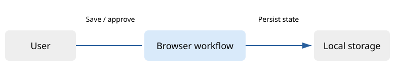

# Architecture

## Context and ownership

The user drafts a note, saves an immutable revision and explicitly approves it. Browser-owned state retains the revision history and current approval in local storage. No backend, identity provider or shared database exists.

<figure><figcaption>One browser owns this synthetic example's state. Blue is the workflow; gray is local persistence. Arrows represent an action or a saved state, not a network API. <a href="assets/context.mmd">Mermaid source</a>.</figcaption></figure>

## Trust and authority

There is no authorization boundary: anyone able to open the demo has all its controls. This must not be mistaken for an authenticated production application. The workflow distinguishes editing from approving a {{revision}}.

## Failure and recovery

Saving a stale revision is rejected by the workflow. Storage exceptions are displayed and state is retained in memory. Reloading restores the last persisted state when local storage is available. There is no backup or multi-user coordination.
